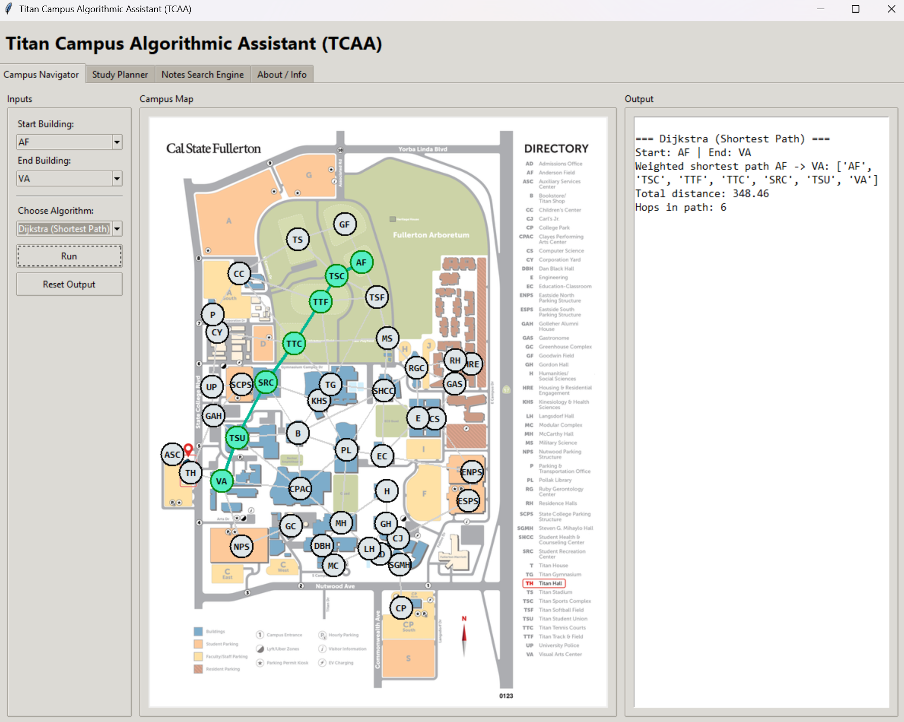
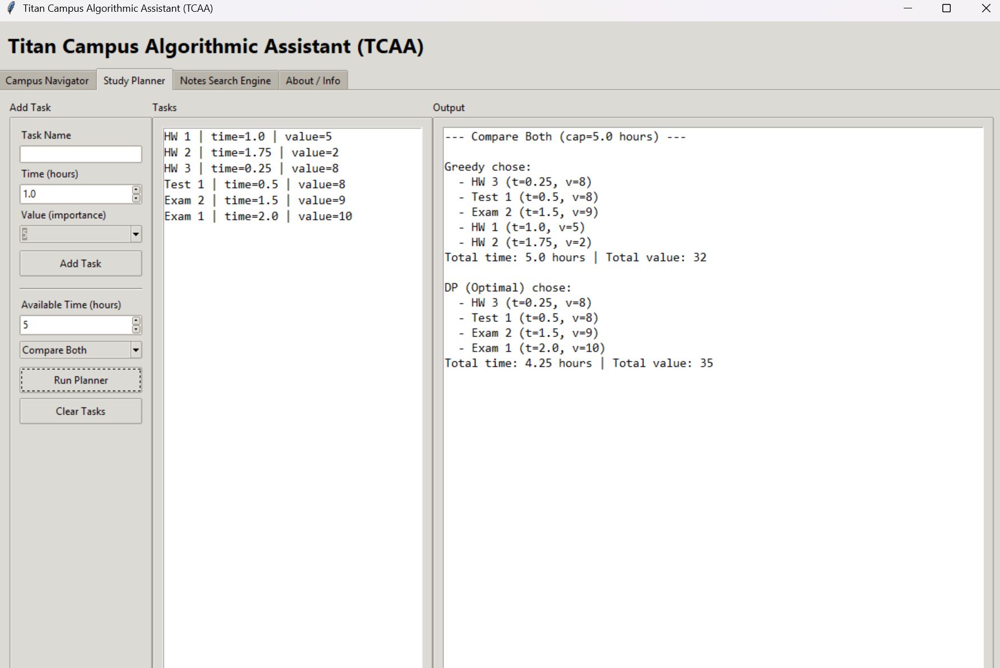
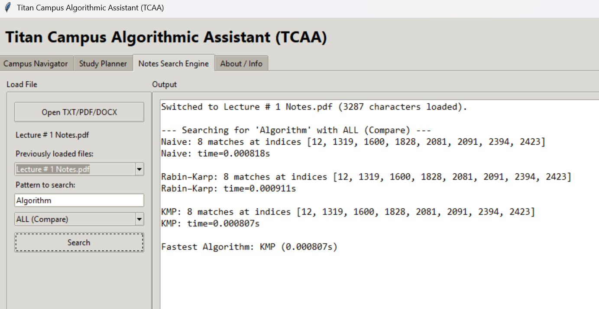
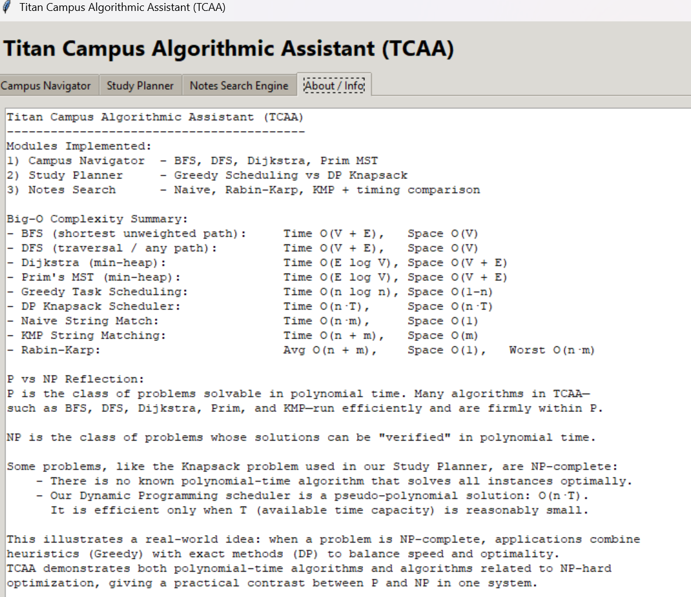

# Titan Campus Algorithmic Assistant (TCAA)

**Titan Campus Algorithmic Assistant (TCAA)** is a Python desktop application developed to demonstrate and explore fundamental computer science algorithms through interactive, student-focused scenarios.

Built with **Python and Tkinter**, TCAA combines graph navigation, study scheduling, and document searching into a single graphical application.

The project was developed as part of **CPSC 335 – Algorithm Engineering** at California State University, Fullerton.

## Application Screenshots

### Campus Navigator
Dijkstra's algorithm finds and highlights the shortest
weighted path between two campus buildings.



### Study Planner
Compare Greedy Scheduling and Dynamic Programming
to find efficient study schedules.



### Notes Search Engine
Compare Naive, Rabin-Karp, and KMP pattern matching
using text extracted from documents.



### About / Info
Review algorithm complexity and fundamental
computer science concepts.



## Features

### 1. Campus Navigator

An interactive campus map that represents buildings as vertices (nodes) and pathways as weighted edges.

**Features:**
- Select starting and destination buildings.
- Visualize a predefined campus graph.
- Zoom and pan across the campus map.
- Animate algorithm traversal and path selection.
- Display calculated routes, traversal orders, and distances.

**Implemented algorithms:**

| Algorithm | Purpose |
|---|---|
| Breadth-First Search (BFS) | Finds the shortest path in terms of edge count |
| Depth-First Search (DFS) | Explores the graph and finds a possible path |
| Dijkstra's Algorithm | Finds the shortest weighted path |
| Prim's Algorithm | Constructs a minimum spanning tree |

The visualization highlights visited nodes, selected routes, and minimum spanning tree edges.

### 2. Study Planner

A task scheduling tool that compares greedy selection with dynamic programming.

Users can:
- Add tasks with names, estimated durations, and importance values.
- Specify the total available study time.
- Choose Greedy Scheduling, Dynamic Programming, or Compare Both.
- Review selected tasks, total study time, and total importance values.

**Algorithms:**

- **Greedy Scheduling:** Selects tasks using a value-to-time ratio heuristic.
- **Dynamic Programming (0/1 Knapsack):** Finds an optimal selection within the discretized time-capacity model.
- **Comparison Mode:** Runs both approaches to illustrate differences between heuristic and optimal solutions.

### 3. Notes Search Engine

A document text-search tool that demonstrates classic string-matching algorithms.

**Supported file formats:**
- `.txt` — Plain text
- `.pdf` — PDF documents using PyPDF2
- `.docx` — Word documents using python-docx

**Implemented algorithms:**

| Algorithm | Description |
|---|---|
| Naive String Matching | Checks possible starting positions |
| Rabin–Karp | Uses hashing for pattern matching |
| Knuth–Morris–Pratt (KMP) | Uses a prefix table to reduce repeated comparisons |

**Features:**
- Load documents from the local computer.
- Switch between previously loaded documents.
- Search for a text pattern using a selected algorithm.
- Display the number of matches and a preview of their positions.
- Measure algorithm execution time.
- Compare all three algorithms and identify the fastest measured execution.

### 4. About / Information

Provides educational information about the algorithms implemented in TCAA, including:

- Algorithm descriptions
- Time and space complexity (Big-O)
- Comparisons between algorithmic approaches
- An introduction to P, NP, and the Knapsack problem

## Technologies

- **Language:** Python 3
- **GUI:** Tkinter
- **Image processing:** Pillow
- **PDF processing:** PyPDF2
- **Word document processing:** python-docx
- **Standard libraries:** pathlib, math, time, and other Python utilities

## Installation

### Prerequisites

- Python 3.11 or a compatible Python 3 version
- Git (if cloning the repository)
- A desktop environment supporting Tkinter

### 1. Clone the repository

```bash
git clone https://github.com/egarciao-dev/TCAA.git
cd TCAA
```

### 2. Create a virtual environment

```bash
python -m venv .venv
```

Activate the environment.

**Windows (PowerShell):**

```powershell
.venv\Scripts\Activate.ps1
```

**macOS / Linux:**

```bash
source .venv/bin/activate
```

### 3. Install dependencies

```bash
python -m pip install -r requirements.txt
```

## Running the Application

From the project's root directory, run:

```bash
python -m src.main
```

This starts the TCAA graphical application.

Once the dependencies are installed, the application operates locally without requiring an internet connection.

## Project Structure

```text
TCAA/
├── assets/
│   └── map_o.png
├── docs/
├── src/
│   ├── __init__.py
│   ├── main.py
│   ├── campus_algorithms.py
│   └── note_search_algorithms.py
├── tests/
├── .gitignore
├── LICENSE
├── README.md
└── requirements.txt
```

The `docs/` and `tests/` directories can be added as supporting documentation and automated tests are developed.

## Algorithm Concepts

TCAA demonstrates several important concepts from algorithm engineering:

- Graph traversal and pathfinding
- Weighted and unweighted graphs
- Minimum spanning trees
- Greedy algorithms
- Dynamic programming
- String-matching algorithms
- Time complexity and performance comparisons

The application is intended primarily as an educational tool rather than a production navigation or scheduling system.

## Testing

TCAA includes automated unit tests for its graph algorithms using Python's built-in `unittest` framework.

The test suite covers:
- BFS shortest paths and unreachable nodes
- DFS traversal and path validation
- Dijkstra's shortest weighted paths
- Prim's minimum spanning tree cost and cycle detection

Run the tests from the project root:

```bash
python -m unittest discover -s tests -v
```

## Future Improvements

Potential improvements include:

- Allowing users to add and modify campus buildings.
- Supporting accessible and temporarily closed pathways.
- Supporting additional graph weight options.
- Adding more comprehensive automated unit tests.
- Expanding algorithm performance comparisons.
- Improving the user interface and documentation.

## License

This project is licensed under the MIT License.

See the [LICENSE](LICENSE) file for details.
